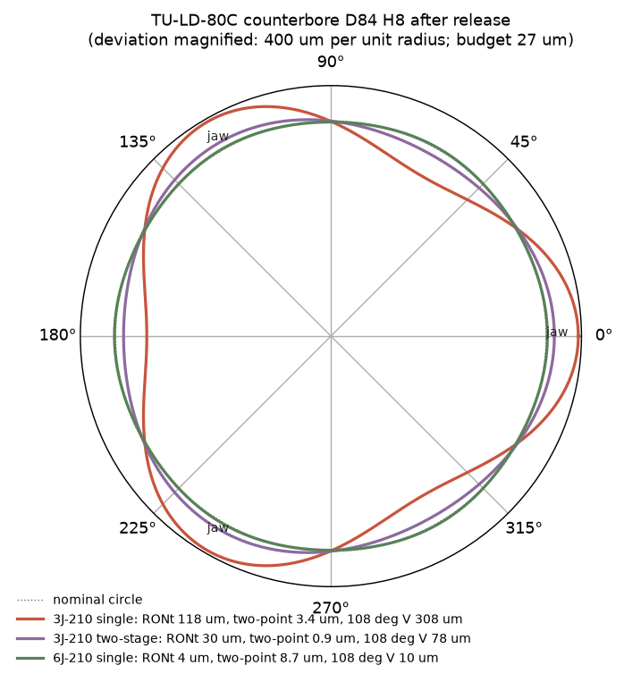
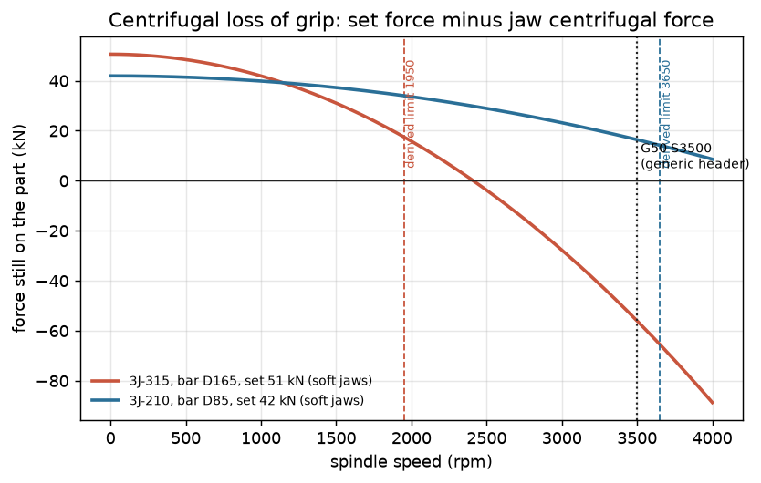
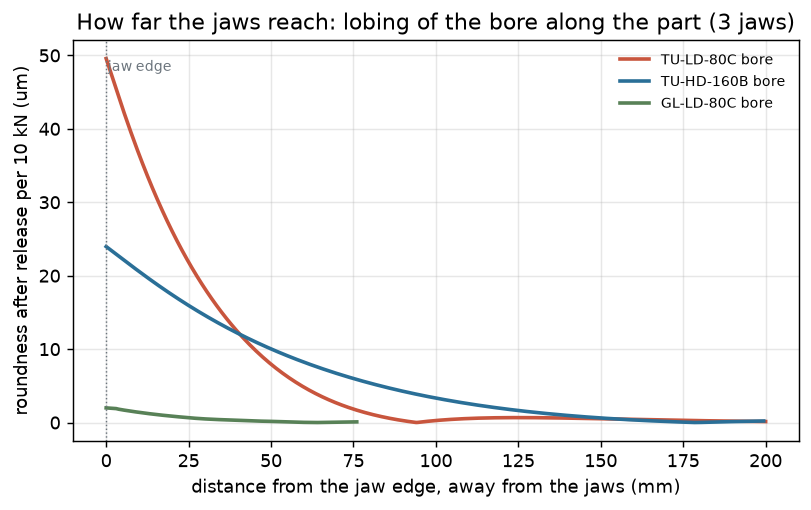
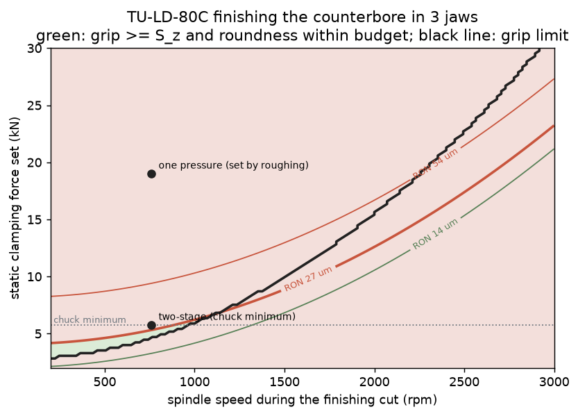
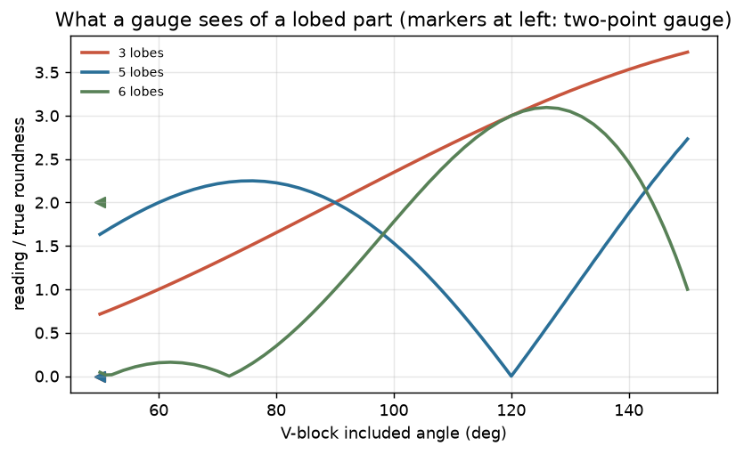
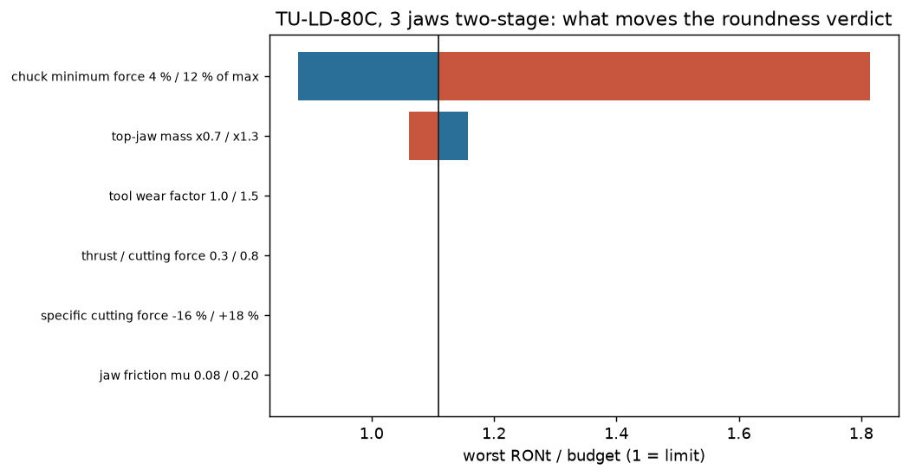
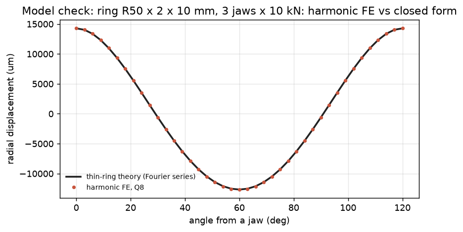

# Workholding for turned hydraulic-cylinder parts: grip, speed limit and squeeze

A lathe program fixes the geometry of a part. Whether the part comes out right also depends on three things most programs leave to the set-up: **how hard the chuck clamps, how fast the spindle may turn, and how much the squeeze deforms the part while it is cut.** Get the first two wrong and the part slips or is thrown. Get the third wrong and a fit measures right with a micrometer and still does not assemble.

This project takes the turned parts of two verified hydraulic cylinders (from [hydraulic-cylinder-design-verification](https://github.com/chad416/hydraulic-cylinder-design-verification): the tube mouth, the gland and the piston of a 160 mm and an 80 mm bore cylinder) and answers, for each part, **which chuck and clamping scheme hold it safely at the programmed speed and keep every fit inside its tolerance after release.** It then writes the lathe programs (FANUC and Sinumerik) and **reads each one back** against the same physics.

The engineering argument, structured as a systems-engineering dossier after Wasson (2016), is in **[DOSSIER.md](DOSSIER.md)** ([PDF](DOSSIER.pdf)). Per-part calculation reports are in [reports/](reports/), the programs in [reports/nc/](reports/nc/).

**Everything here is analysis and simulation.** No part was turned and no program was run on a lathe. Chuck data are assumed catalogue orders of magnitude; the VDI 3106 method is quoted from memory. See [Limits](#limits).



## What it found

| part | 3 jaws, one pressure: worst roundness / budget | what decides | chosen | programs |
|---|---|---|---|---|
| TU-LD-80C | 4.36 | chuck minimum force; jaw contact count | 6J-210 single (G50 800 / 800) | PASS |
| TU-HD-160B | 2.13 | chuck minimum force (two-stage passes at 0.87) | 6J-315 single (G50 350 / 350) | PASS |
| GL-LD-80C | 0.25 | nothing: the jaws do not reach the fits | 3J-210 single (G50 800 / 800) | PASS |
| GL-HD-160B | 0.11 | nothing: the jaws do not reach the fits | 3J-315 single (G50 350 / 350) | PASS |
| PI-LD-80C | 0.10 | nothing: the jaws do not reach the fits | 3J-210 single (G50 1450 / 1450) | PASS |
| PI-HD-160B | 0.05 | speed limit only (G50 from the grip at speed) | 3J-315 single (G50 1000 / 1000) | PASS |

1. **A generic `G50 S3500` lets the large chuck open.** The part-family generator's programs face the solid bar to X0 under G96, so the spindle reaches the G50 limit at the end of every facing cut. On the 315 mm chuck for the 160 mm parts, the static force their own heaviest cut needs is 50.6 kN, but the soft jaws' centrifugal force at 3500 rpm is 106.6 kN: the grip is gone. The soft jaws are 1.33 × heavier (sum of m·r) than the chuck's speed rating assumes. The safe limit is 1950 rpm. On the 210 mm chuck the same header is safe (16.4 kN left).
2. **The thin tube comes out three-lobed, and a micrometer cannot see it.** A toleranced seat (D84 H8) at the mouth of the 90 × 5 mm tube, turned in three jaws at the single pressure the roughing needs (19 kN), is **117.6 µm** out of round after release against a budget of **27 µm**. A two-point gauge sees **3.4 µm** of it: a three-lobed shape has a constant two-point size. A 108° vee shows it 2.6 × amplified.
3. **Two-stage clamping does not fix it: the chuck minimum decides.** The finishing cut needs only 4.8 kN, but the chuck cannot be set below 5.8 kN, which still leaves **30.0 µm**. No cutting-force input moves this verdict; only the chuck minimum and the jaw mass do. More contact points do: a **six-jaw** chuck gives **4.4 µm** at one pressure.
4. **The same model says the bar-made glands and pistons need nothing special.** Gripped on the bar behind the part, the jaws do not reach the toleranced surfaces: a plain three-jaw chuck uses at most 25 % of any roundness budget. The jaws reach a long way along a thin tube and only millimetres into a thick ring.
5. **The read-back found a real planner error.** Entering a groove to finish its bottom is a full-width plunge; the planner had costed it as a light side pass, and the verifier flagged the grip at the low preset. Fixed in the planner (decision D-07).
6. **The models reproduce what they should.** The harmonic FE matches thin-ring theory for 2, 3 and 6 jaws (0.5 %), Roark's two-point ring coefficient 0.1488 and Lamé; the vee-block kinematics give 2.62 × for three lobes in 108° and 2.0 × for five lobes in 60°; the two-point gauge reads zero for odd lobes.













## How it works

```
data/parts.json (from project 13), machine.json (chucks), materials.json (Kienzle), tools.json
  process.py   operation plan per part (face, rough/finish OD and bore, grooves); 6 strategies =
               {3 jaws, 6 jaws, pie jaws} x {one pressure, two-stage}
  cutting.py   Kienzle force with rake/speed/wear/process factors, Colwell force direction,
               Ra with the ploughing term; finishing feed solved from the Ra requirement
  clamp.py     VDI 3106 form: force each cut needs, jaw centrifugal loss, G50 per stage
  harmfe.py    Fourier-harmonic axisymmetric FE (Q8 in the r-z section, harmonics k = 0, n, 2n, ...)
  form.py      released profile = mirrored squeeze; roundness, two-point size, MCC/MIC, vee gauge
-> aoa.py (5 criteria, +-10 % weights, 2000 random weight sets) -> fmea.py -> requirements.py
-> gcode.py (FANUC / Sinumerik: presets M61/M62, G50/LIMS, dwells) -> verify.py (read-back, rules W1-W7)
-> audit07.py (speed-limit audit of project 07's programs) -> report.py, plots.py
```

## Tests

`python -m pytest`: 22 tests.
- **Harmonic FE:** thin-ring theory (2, 3, 6 jaws, pie jaws); Roark's two-point coefficient; Lamé; the Fourier series rebuilds the jaw pressure.
- **Gauges:** vee-block sensitivity for 2, 3, 5 lobes; two-point blindness to odd lobes.
- **ISO 286** table against the standard tolerance unit; **Kienzle** and **Ra** closed forms; **centrifugal force** and speed limit consistency.
- **Findings:** the thin-tube verdicts (three jaws fail, two-stage fails on the chuck minimum, six jaws pass), bar work passes, the 315 mm chuck opens at G50 S3500.
- **Programs:** the generated FANUC and Sinumerik programs pass the read-back, and the read-back agrees with the planner's finishing forces within 2 %; deliberate edits (preset switched while turning, dwell removed, G50 removed, low preset too low) are caught.

CI also reads back every committed program in `reports/nc/` and runs the audit of project 07's programs.

## Run it

```bash
pip install -r requirements.txt
python -m pytest
python -m clampform report                      # all parts -> reports/, reports/nc/, docs/img/ (about 30 min)
python -m clampform verify reports/nc/TU-LD-80C.nc TU-LD-80C
python -m clampform audit07
python tools/export_pdf.py                      # DOSSIER.md -> DOSSIER.pdf (needs `markdown` and Edge or Chrome)
```

## Limits

- **Simulation only.** DOSSIER section 9 is the plan to validate the models on turned parts (roundness instrument, slip test, groove gauge).
- **Chuck data are assumed** (`data/machine.json`), including the minimum controllable force that decides finding 3.
- **Jaws are force-controlled arc loads**; contact stiffness, indentation and friction in the contact are not modelled.
- **Kienzle values** for C45 and E355 are those of the nearest tabulated steel; the verdicts were shown not to depend on them.
- **VDI 3106 and EN 1550 were not available**; the method is quoted from memory.
- **The tube seat is a design variant** (a stepped-gland seat), not part of the cylinder design; it stands for any toleranced turned diameter near the mouth of a thin tube.
- **Chatter is not modelled.**

## Repository

```
clampform/    harmfe, ring, form, cutting, clamp, process, aoa, fmea, requirements, gcode, verify, audit07, analysis, plots, report, cli
data/         parts.json, machine.json, materials.json, tools.json, p07/ (project 07 programs for the audit)
DOSSIER.md    the systems-engineering dossier (+ DOSSIER.pdf); OPEN_ITEMS.md
docs/img/     figures from the report run
reports/      per-part reports, SUMMARY.md, nc/ (FANUC .nc and Sinumerik .mpf)
tests/        pytest
tools/        export_pdf.py
```

MIT licence.
